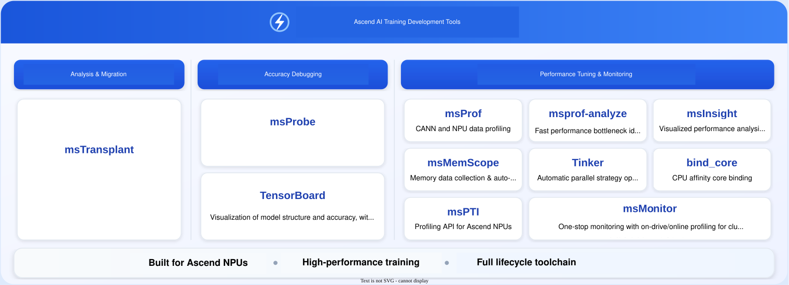

<h1 align="center">MindStudio Training Tools</h1>

<b>Ascend AI Training Development Toolchain</b>

 
 
 
 
 
 

English | [简体中文](./README.md)

## ✨ What's New

🔹 **[Mar 28, 2026]**: The Accuracy Debugging module (debug directory) has been officially sunset. For details, see the [Announcement](https://gitcode.com/Ascend/mstt/discussions/2)
🔹 **[Feb 25, 2026]**: The Tinker parallel strategy automatic tuning system is officially open-sourced. For details, see the [Tinker Project](https://gitcode.com/Ascend/mstt/tree/master/profiler/tinker).
🔹 **[Jan 12, 2026]**: The license for this repository has been updated. For details, see the [Announcement](https://gitcode.com/Ascend/mstt/discussions/1).
🔹 **[Dec 31, 2025]**: The MindStudio training development toolchain is fully open source.

## ℹ️ Introduction

MindStudio Training Tools (msTT) is a training development toolchain focused on solving key challenges in model training. It provides three core tools for analysis & migration, accuracy debugging, and performance tuning, to efficiently address issues such as migration failures, loss anomalies, and performance bottlenecks, delivering a minimalist development experience with optimized accuracy and performance.

## ⚙️ Features

msTT provides the following series of tools:

| Category | Tool                                                                                      | Function                                                |
|:--:|:------------------------------------------------------------------------------------------|:---------------------------------------------------|
| Migration | [**msTransplant**](./msfmktransplt/)                                                      | **【Analysis and migration】** One-click migration of PyTorch training scripts to the Ascend NPU, supporting migration with minimal or zero code changes. |
| Accuracy | [**msProbe**](https://gitcode.com/Ascend/msprobe)                                         | **【Accuracy debugging】** Ascend full-scenario accuracy tool for training accuracy debugging and issue locating.                |
| Accuracy | [**TensorBoard**](https://gitcode.com/Ascend/msprobe/tree/master/plugins/tb_graph_ascend) | **【Hierarchical visualization】** Hierarchically visualizes model structure and accuracy, supporting debugging and comparison with benchmark models to locate accuracy issues.         |
| Performance | [**msProf**](https://gitcode.com/Ascend/msprof)                                           | **【Model tuning】** Full-scenario performance tuning base, profiling CANN and NPU data to improve device tuning efficiency.    |
| Performance | [**msprof-analyze**](https://gitcode.com/Ascend/msprof-analyze)                           | **【Performance analysis】** Performs performance analysis based on collected data to quickly identify performance bottlenecks.                   |
| Performance | [**msMemScope**](https://gitcode.com/Ascend/msmemscope)                                   | **【Memory tuning】** Dedicated memory tuning tool for multi-dimensional memory collection at the entire network level, supporting automatic diagnosis and optimization analysis.        |
| Performance | [**msInsight**](https://gitcode.com/Ascend/msinsight)                                     | **【Visualized tuning】** Visualized performance analysis covering system, operator, and service-oriented scenarios, assisting in performance diagnosis.        |
| Performance | [**Tinker**](./profiler/tinker)                 | **【Parallelism optimization】** Automatic parallelism strategy optimization for foundation models. It evaluates single-node NPU based on training scripts and recommends high-performance parallel solutions. |
| Performance | [**bind_core**](./profiler/affinity_cpu_bind)   | **【One-click core binding】** CPU core binding tool that binds cores according to CPU affinity policies without intrusive project modifications.       |
| Performance | [**msPTI**](https://gitcode.com/Ascend/mspti)                                             | **【Performance profiling】** Ascend-oriented profiling API, enabling the development of NPU application performance analysis tools. |
| Monitoring | [**msMonitor**](https://gitcode.com/Ascend/msmonitor)                                     | **【Online monitoring】** One-stop monitoring, supporting drive persistence and online sampling, for cluster monitoring and issue locating.           |

## 🚀 Quick Start

For PyTorch and MindSpore scenarios, executable samples are provided to connect migration analysis, accuracy debugging, and performance tuning, helping you quickly get started with end-to-end training optimization. For quick access to the tools, see the [msTT Quick Start Guide](docs/en/quick_start/mstt_quick_start.md).

## 📦 Installation Guide

Follow the links in the table above to access the corresponding source repositories, and see the Installation Guide in their README files.

## 📘 User Guide

For detailed usage instructions of each tool, refer to the README file in its source code repository, or directly jump via the links in the function introduction table above. To select a tool based on your scenario, see the [msTT Tool Selection Guide](./docs/en/user_guide/mstt_user_guide.md).

## 🌌 Intelligent Search

To make it easier to access information in the documentation, we provide several efficient search methods:
🔹 [AI Q&A (DeepWiki)](https://deepwiki.com/mindstudio-docs/master): Ask questions in natural language to quickly understand the project architecture and relationships between modules.
🔹 [AI Q&A (ZRead)](https://zread.ai/mindstudio-docs/master): Provides a better Chinese Q&A experience and accurately locates feature usage and details.
🔹 [Precise Search (ReadTheDocs)](https://mindstudio-docs-master.readthedocs.io/): Search the full text by keyword to find information about interfaces, parameters, and error messages directly.

## 🛠️ Contribution Guide

Contributions to the project are welcome. For details, see [Contribution Guide](./docs/en/contributing/contributing_guide.md).

## ⚖️ Related Notes

🔹 [License Notice](./docs/en/legal/license_notice.md)
🔹 [Security Statement](./docs/en/legal/SECURITY.md)
🔹 [Disclaimer](./docs/en/legal/disclaimer.md)

## 🤝 Suggestions and Communication

We welcome everyone to contribute to the community. If you have any questions or suggestions, please submit an [issue](https://gitcode.com/Ascend/msprof/issues), and we will respond as soon as possible. Thank you for your support.

| Instant Messaging (WeChat Group) | Official News (Official Account) | In-Depth Support (Assistant / Forum) |
| :---: | :----: | :---- |
|  *Scan to join the technical discussion group* |  *Scan to follow the official account* | Scan the QR code to join the group and follow the official account for the fastest way to connect with MindStudio users and developers:  **Ask questions:** Discuss technical issues with community members in real time **Stay updated:** Get the latest version releases and feature update notifications firsthand  **Share experience:** Exchange best practices and practical insights with fellow developers      **More support channels**: 👉 Ascend Assistant:   👉 Ascend Forum:  |

## 🙏 Acknowledgments

msTT is jointly contributed by the following departments of Huawei:
🔹 Ascend Computing MindStudio Development Dept
🔹 Ascend Computing Ecosystem Enablement Dept
🔹 Ascend AI Cloud Service
🔹 2012 Distributed Parallel Computing Lab
🔹 2012 Network Technology Lab
Thanks for every PR from the community, and contributions to msTT are welcome.
