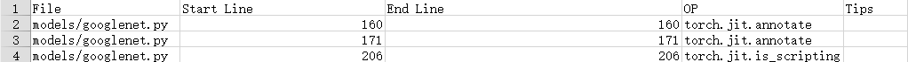
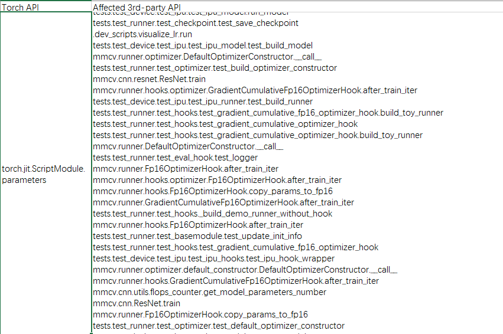
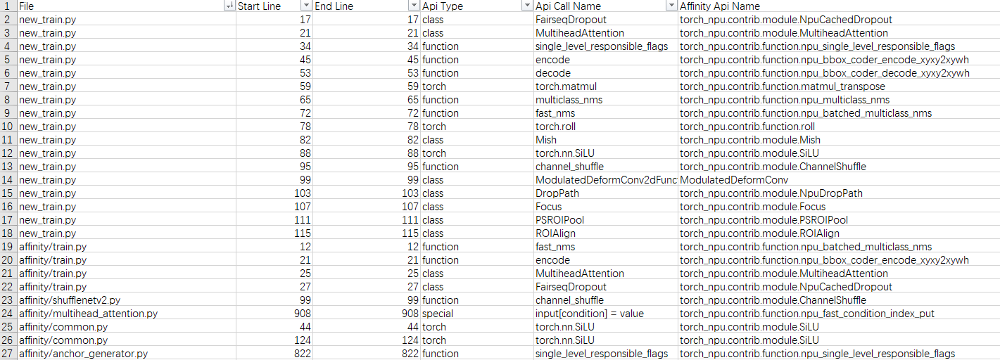
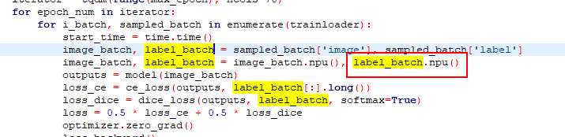
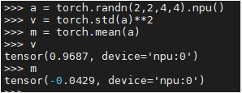
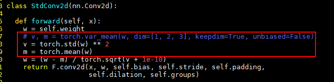

# MindStudio Transplant (msTransplant)

## Overview

Ascend NPU is a rising star in AI computing, but most training and online inference scripts are currently based on GPUs. Due to architectural differences between NPUs and GPUs, GPU-based training and online inference scripts cannot be directly used on NPUs.

MindStudio Transplant (msTransplant), a migration analysis tool, provides one-click migration of PyTorch training scripts to Ascend NPU, allowing developers to complete migration with minimal or zero code modifications. The tool offers the PyTorch Analyse function, which helps users analyze the support status of APIs, third-party library APIs, affinity API analysis, and dynamic shapes in PyTorch training scripts. It also provides two migration methods: Automatic migration and PyTorch GPU2Ascend tool migration, which migrate GPU-based scripts to NPU-based scripts. This automated approach saves the learning cost and workload of manual script migration, significantly improving migration efficiency.

- (Recommended) Automatic migration: Minimal modifications are required. You only need to import library code into the training script, and it can run directly on the Ascend NPU platform after migration.
- PyTorch GPU2Ascend tool migration: The migration process generates analysis files, allowing users to view API support analysis reports and the modifications made to the original training script during migration. It also supports migrating single-device scripts to multi-device scripts.

> [!NOTE]
> Before using the analysis and migration tool, users should verify the correctness of all parameters in the original project. The tool should only be used for migration after the original project has been successfully run.

## Preparation

### Environment Setup

The actual execution of the functions of this tool depends solely on the CPU, and the following mandatory dependencies must be installed in advance:

```shell
pip3 install pandas         # Required, pandas version must be greater than or equal to 1.2.4
pip3 install libcst         # Required, semantic analysis library for parsing Python files
pip3 install prettytable    # Required, for visualizing data in chart form
pip3 install jedi           # Required, used for cross-file parsing
```

After the migration function is executed, if you need to run the migrated training script on the NPU, you must also install the following additional dependencies:

- Install the matching version of the CANN Toolkit development suite package and the ops operator package. See the [CANN Quick Installation](https://www.hiascend.com/en/cann/download).

- Configure environment variables.

    After installing the CANN software, when using the CANN runtime user for compilation and runtime operations, you need to log in to the environment as the CANN runtime user and execute the `source ${install_path}_set_env.sh` command to set the environment variables. Here, `${install_path}` is the installation directory of the CANN software, for example: `/usr/local/Ascend/cann`.

    > [!NOTE]
    > The above environment variables only take effect in the current window. Users can write the above command into the ~.bashrc file to make it permanently effective. The steps are as follows:
    > 1. As the installation user, execute `vi ~.bashrc` in any directory to open the `.bashrc` file, and add the above environment variables at the end of the file.
    > 2. Execute the `:wq!` command to save the file and exit.
    > 3. Execute the `source ~.bashrc` command to make the environment variables take effect.

### Constraints

- The analysis and migration tool currently supports the analysis and migration of training scripts for PyTorch versions 2.1.0, 2.6.0, 2.7.1, and 2.8.0.
- The original script must be able to run successfully in a GPU environment based on Python 3.7 or later.
- The execution logic after analysis and migration must remain consistent with that before migration.
- If the original code calls third-party libraries, adaptation issues may arise during the migration process. Before migrating the original code, users need to install the Ascend-adapted versions of the third-party libraries based on the libraries already called. For information on adapted third-party libraries and usage guides, please refer to the [TorchNPU Supporting Software Libraries](https://gitcode.com/Ascend/docs/blob/master/FrameworkPTAdapter/26.1.0/en/supported_suites_and_third_party_libraries/supported_suites_and_third_party_libraries.md).
- The FusedAdam optimizer used in APEX does not support migration using the automatic migration and PyTorch GPU2Ascend tools. If the original code contains this optimizer, users need to modify it themselves.
- The current analysis tool does not support affinity API analysis for native functions such as `self.dropout()`, `nn.functional.softmax()`, `torch.add`, `bboexs_diou()`, `bboexs_giou()`, `LabelSmoothingCrossEntropy()`, or `ColorJitter`. If the original training script involves any of the above native functions, refer to the "Python APIs > torch_npu.contrib" section in the [TorchNPU Custom API Reference](https://gitcode.com/Ascend/op-plugin/blob/master/docs/en/custom_APIs/overview.md) for analysis and replacement.
- If the user's training script contains the `amp_C` module, which is unsupported on the Ascend NPU platform, the user must manually delete the code related to `import amp_C` before proceeding with training.
- Since the converted script runs on a different platform than the original script, the migrated script may throw exceptions during debugging and execution due to reasons such as operator differences, causing the process to terminate. Such exceptions require further debugging and resolution by the user based on the error information.

### Security Precautions

- When using the tool in a Linux environment, for security and the principle of least privilege, this tool should not be operated using high-privilege accounts such as root. You are advised to install and execute it with normal user permissions.
- When using the tool in a Linux environment, ensure that the umask value of the user executing the tool is greater than or equal to 0027 before use. Otherwise, the permissions on data files and directories generated by the tool may be excessively permissive.
- When using the tool in a Linux environment, users must ensure the principle of least privilege is followed. For example, files input to the tool must not be writable by other users. In scenarios with stricter security requirements, it must also be ensured that input files are not writable by group users.
- Since this tool depends on CANN, for security purposes, the CANN package installed by default under the same low-privilege user should be used. After executing the source command, do not arbitrarily modify the environment variables involved in `set_env.sh`.
- This tool is intended for development and debugging. It is not recommended for use in production environments.

## Quick Start

### Overview

The Analysis and Migration Tool can migrate GPU-based training scripts to scripts that support NPU, significantly improving script migration speed and reducing developer workload. This sample allows developers to quickly experience the migration efficiency of Automatic Migration (recommended) and the PyTorch GPU2Ascend tool.

This sample uses the ResNet-50 model with the ImageNet dataset.

### Environment Setup

- Prepare a training server based on the Atlas training series and install the corresponding driver and firmware. For driver and firmware installation, refer to the [CANN Software Installation Guide](https://www.hiascend.com/document/detail/en/canncommercial/latest/softwareinst/instg/instg_0000.html), specifically its "[Installing NPU Driver Firmware](https://www.hiascend.com/document/detail/en/canncommercial/latest/softwareinst/instg/instg_0005.html)" section.
- Install the development suite package Ascend-cann-toolkit and the ops operator package. For details, refer to the [CANN Software Installation Guide](https://www.hiascend.com/document/detail/en/canncommercial/latest/softwareinst/instg/instg_0000.html), specifically its "[Installing CANN](https://www.hiascend.com/document/detail/en/canncommercial/latest/softwareinst/instg/instg_0089.html)" section.
- Taking PyTorch 2.1.0 as an example, refer to [TorchNPU Software Installation](https://gitcode.com/Ascend/pytorch/blob/master/docs/en/installation_guide/building_from_source.md) to complete the installation of the PyTorch framework and the TorchNPU plugin.
- Download the [main.py](https://gitee.com/ascend/mstt/blob/master/sample/transfer_to_npu/main.py) file and place the obtained ResNet50 model in a user-defined path (such as `/home/user`).

### Automatic Migration (Recommended)

With minimal modifications, you only need to import library code into the training script, and it can run directly on the Ascend NPU platform after migration.

1. Import the library code for automatic migration into the training script [main.py](https://gitee.com/ascend/mstt/blob/master/sample/transfer_to_npu/main.py) file.

    ```python
    from torch.utils.data import Subset
    import torch_npu
    from torch_npu.contrib import transfer_to_npu
    .....
    ```

2. Switch the directory to the path where the migrated training script is located (using `/home/user` as an example), and run the following command to perform training with a dummy dataset. The migrated training script can run normally on the NPU.

    Iteration logs start printing, indicating that the training function migration is successful.

    ```shell
    cd /home/user
    python main.py -a resnet50 --gpu 1 --epochs 1 --dummy  # --gpu 1 means using device 1, --epochs 1 means the number of iterations is 1
    ```

3. The migration tool automatically saves the weights successfully, indicating that the migration is successful.

### Migration with PyTorch GPU2Ascend

1. Go to the path where the migration tool is located.

    ```shell
    cd msfmktransplt/src/ms_fmk_transplt/
    ```

2. Execute the script migration task, and configure the information by referring to [**Table 6** Parameter Description](#parameter-description).

    ```shell
    bash pytorch_gpu2npu.sh -i /home/user -o /home/out -v 2.1.0
    ```

    `/home/user` is the original script path, `/home/out` is the output path for the script migration result, and 2.1.0 is the PyTorch framework version of the original script.

3. Switch the directory to the path of the training script after migration (using /home/user as an example), and execute the following command to perform training with a virtual dataset. The training script after migration can run normally on the NPU.

    Iteration logs start to print, indicating that the training function migration is successful.

    ```shell
    cd /home/user
    python main.py -a resnet50 --gpu 1 --epochs 1 --dummy  # --gpu 1 indicates using device 1, and --epochs 1 means the number of iterations is 1
    ```

4. After the script migration is complete, go to the output path of the script migration result to view the result files.

    > [!NOTE]
    >
    > The migration analysis is automatically started during the script migration process. By default, the analysis mode of torch_apis and affinity_apis is used. For details about the corresponding result files, see [Output File Description](#output-file-description).

5. The migration tool automatically saves the weights successfully, indicating that the migration is successful.

## Migration Analysis

### Function Description

PyTorch Analyse provides analysis scripts to help users analyze the support status of APIs, third-party library suites, affinity API analysis, and dynamic shapes in GPU-based PyTorch training scripts before performing migration operations. For details, see [**Table 1** Analysis mode introduction](#analysis-mode-introduction).

The analysis script is located at: `msfmktransplt/src/ms_fmk_transplt/pytorch_analyse.sh`.

**Table 1** Analysis mode introduction <a id="analysis-mode-introduction"></a>

|Analysis Mode|Analysis Script|Analysis Result|Tuning Suggestion|
|--|--|--|--|
|Third-party library suite analysis|Requires the user to provide the source code of the third-party library suite to be analyzed.|Quickly obtain information about unsupported third-party library APIs and CUDA in the source code.<br>Note: A third-party library API refers to a function in the third-party library code. If a function body uses an unsupported Torch operator or CUDA custom operator, this function is an unsupported API of the third-party library. If other functions in the third-party library call these unsupported APIs, those calling functions are also unsupported APIs.| - |
|API support status analysis|Requires the user to provide the PyTorch training script to be analyzed.|Quickly obtain information about unsupported Torch APIs and CUDA APIs in the training script.|Output expert suggestions for API precision and performance tuning in the training script.|
|Dynamic shape analysis|Requires the user to provide the PyTorch training script to be analyzed.|Quickly obtain dynamic shape information contained in the training script.|-|
|Affinity API analysis|Requires the user to provide the PyTorch training script to be analyzed.|Quickly obtain information about replaceable affinity APIs in the training script.|- |

#### Command Format

```shell
bash pytorch_analyse.sh -i <input> -o <output> -v <version> [-m <mode>] [-env <env_path>] [-api <api_files>]
```

"[]" indicates optional parameters, which can be omitted in actual use. "<>" indicates variables.

### Parameter Description

**Table 2** Parameter description<a id="parameter-description1"></a>

|Name|Optional/Required|Description|
|--|:-:|--|
|`-i` or `--input`|Required|Path to the folder containing the training script to be analyzed or the source code of the third-party library suite.|
|`-o` or `--output`|Required|Output path for the analysis result files. An xxxx_analysis folder will be generated under this path. The user must ensure that the output path for the analysis result files exists before running; otherwise, the analysis and migration tool will report an error.|
|`-v` or `--version`|Required|PyTorch version of the training script or third-party library suite source code to be analyzed.|
|`-m` or `--mode`|Optional|Analysis mode. The default value is torch_apis. Options are:<br>&#8226; torch_apis: API support status analysis<br>&#8226; third_party: Third-party library suite analysis<br>&#8226; affinity_apis: Affinity API analysis<br>&#8226; dynamic_shape: Dynamic shape analysis|
|`-env` or `--env-path`|Optional|PYTHONPATH environment variable path to be added during analysis. This parameter takes effect only after jedi is installed.<br>Specifies the path of the third-party library to be analyzed, and analyzes the list of unsupported third-party library APIs in the current script.|
|`-api` or `--api-files`|Optional|Analysis result file for unsupported third-party library APIs.<br>If the third-party library has unsupported APIs and custom functions call unsupported Torch APIs, you can use the Torch API analysis function.|
|`-h` or `--help`|Optional|Prints help information.|

### Usage Example (API Support Status Analysis)

1. Navigate to the directory where the analysis tool is located.

    ```shell
    cd msfmktransplt/src/ms_fmk_transplt
    ```

2. Start the analysis task.

    Refer to [Table 2 Parameter Description](#parameter-description1) for configuration information, and run the following command to start the analysis task.

    ```shell
    bash pytorch_analyse.sh -i /home/xxx/analysis -o /home/xxx/analysis_output -v 2.1.0
    ```

    Where `/home/xxx/analysis` is the path of the script to be analyzed, `/home/xxx/analysis_output` is the output path for the analysis result, and 2.1.0 is the framework version of the script to be analyzed.

    If the analysis mode specified by the `-m` parameter is dynamic_shape, after the analysis task is completed, you need to modify the training script by referring to [Training Configuration](#training-configuration) to obtain the dynamic shape analysis report.

3. After the analysis is complete, go to the script analysis result output path and view the analysis report. For details, see [Output File Description](#output-file-description).

### Usage Example (API Analysis for Third-Party Libraries That Do Not Support Migration)

1. Go to the path where the analysis tool is located.

    ```shell
    cd msfmktransplt/src/ms_fmk_transplt
    ```

2. Use the third-party library suite analysis function of the `-m` parameter to obtain the list of APIs that do not support migration in the third-party library (csv file).

    ```shell
    bash pytorch_analyse.sh -i third_party_input_path -o third_party_output_path -v 2.1.0 -m third_party
    ```

    `third_party_input_path` is the path to the third-party library folder, `third_party_output_path` is the output path for the results, and 2.1.0 is the framework version of the script to be analyzed.

    After this command is executed, a list of APIs in the third-party library that are unsupported for migration, that is, the `framework_unsupported_op.csv` file, is generated in the `third_party_output_path` directory.

3. Pass the CSV file obtained in the previous step to `-api` to get the information about the third-party library APIs in the current training script that are unsupported for migration.

    ```shell
    bash pytorch_analyse.sh -i input_path -o output_path -v 2.1.0 -api third_party_output_path/framework_unsupported_op.csv
    ```

    `input_path` is the path to the model script folder, and `output_path` is the output path for the results.

4. After the analysis is complete, go to the script analysis result output path and view the analysis report. For details, see [Output File Description](#output-file-description).

### Output File Description

- When the analysis mode is "torch_apis", the analysis results are as follows:

    ```text
    ├── xxxx_analysis     // Analysis result output directory
    │   ├── cuda_op_list.csv             // CUDA API list
    │   ├── unknown_api.csv              // List of APIs with uncertain support status
    │   ├── unsupported_api.csv          // Unsupported API list
    │   ├── api_precision_advice.csv    // Expert advice on API precision tuning
    │   ├── api_performance_advice.csv  // Expert advice on API performance tuning
    │   ├── pytorch_analysis.txt         // Analysis process log
    ```

    **Table 3** Introduction to CSV files in "torch_apis" mode

    |File Name|Description|
    |--|--|
    |unsupported_api.csv|A list of APIs not supported by the current framework. You can seek help from the Ascend open-source community. For details, see [Figure 1 Example of an unsupported API list](#example-of-an-unsupported-api-list).|
    |cuda_op_list.csv|CUDA API information contained in the current training script.|
    |unknown_api.csv|A list of APIs with uncertain support status. For specific PyTorch API information, see [Table 4 PyTorch API interface information](#pytorch-api-interface-information). If training fails, you can seek help from the [Ascend open-source community](https://gitcode.com/Ascend/pytorch).|
    |api_precision_advice.csv|Expert advice for precision tuning in the current training script. In addition, you can use the [msProbe](https://gitcode.com/Ascend/msprobe) tool for tuning.|
    |api_performance_advice.csv|Expert advice and guidance for performance tuning in the current training script. In addition, you can use the [Ascend PyTorch Profiler](https://www.hiascend.com/document/detail/en/CANNCommunityEdition/latest/devaids/Profiling/atlasprofiling_16_0033.html) tool for tuning. The analysis results are based on the API interface information of the native PyTorch framework. For details, see [Table 4 PyTorch API interface information](#pytorch-api-interface-information).|

    **Figure 1** Example of an unsupported API list<a id="example-of-an-unsupported-api-list"></a>

    **Table 4** PyTorch API interface information<a id="pytorch-api-interface-information"></a>

    | PyTorch Framework Version | API Information Reference Link | TorchNPU Version | CANN Version |
    |---|---|---|---|
    | 2.8.0 | [PyTorch2.8.0](https://www.hiascend.com/document/detail/en/Pytorch/latest/apiref/PyTorchNativeapi/docs/en/native_apis/pytorch_2-8-0/overview.md) | [7.2.0](https://www.hiascend.com/developer/download/commercial/result?module=pt) | [8.3.RC1](https://www.hiascend.com/developer/download/community/result?module=cann&cann=8.3.RC1) |
    | 2.7.1 | [PyTorch2.7.1](https://www.hiascend.com/document/detail/en/Pytorch/latest/apiref/PyTorchNativeapi/docs/en/native_apis/pytorch_2-7-1/overview.md) | [7.2.0](https://www.hiascend.com/developer/download/commercial/result?module=pt) | [8.3.RC1](https://www.hiascend.com/developer/download/community/result?module=cann&cann=8.3.RC1) |
    | 2.6.0 | PyTorch2.6.0 | [7.1.0](https://www.hiascend.com/developer/download/commercial/result?product=4&model=8&solution=c5b8ed4e2c804f70906a0cdffee12b9f) | [8.2.RC1](https://www.hiascend.com/developer/download/community/result?module=cann&cann=8.2.RC1) |
    | 2.5.1 | PyTorch2.5.1 | [7.1.0](https://www.hiascend.com/developer/download/commercial/result?product=4&model=8&solution=c5b8ed4e2c804f70906a0cdffee12b9f) | [8.2.RC1](https://www.hiascend.com/developer/download/community/result?module=cann&cann=8.2.RC1) |
    | 2.3.1 | PyTorch2.3.1 | [7.1.0](https://www.hiascend.com/developer/download/commercial/result?product=4&model=8&solution=c5b8ed4e2c804f70906a0cdffee12b9f) | [8.2.RC1](https://www.hiascend.com/developer/download/community/result?module=cann&cann=8.2.RC1) |
    | 2.5.1 | PyTorch2.5.1 | [7.0.0](https://www.hiascend.com/developer/download/commercial/result?product=4&model=14&solution=95660a4d75cf44a49463373d356c1a78) | [8.1.RC1](https://www.hiascend.com/developer/download/community/result?module=cann&cann=8.1.RC1) |
    | 2.4.0 | PyTorch 2.4.0 | [7.0.0](https://www.hiascend.com/developer/download/commercial/result?product=4&model=14&solution=95660a4d75cf44a49463373d356c1a78) | [8.1.RC1](https://www.hiascend.com/developer/download/community/result?module=cann&cann=8.1.RC1) |
    | 2.3.1 | PyTorch 2.3.1 | [7.0.0](https://www.hiascend.com/developer/download/commercial/result?product=4&model=14&solution=95660a4d75cf44a49463373d356c1a78) | [8.1.RC1](https://www.hiascend.com/developer/download/community/result?module=cann&cann=8.1.RC1) |
    | 2.1.0 | PyTorch 2.1.0 | [7.0.0](https://www.hiascend.com/developer/download/commercial/result?product=4&model=14&solution=95660a4d75cf44a49463373d356c1a78) | [8.1.RC1](https://www.hiascend.com/developer/download/community/result?module=cann&cann=8.1.RC1) |
    | 2.1.0 | PyTorch 2.1.0 | [6.0.0](https://www.hiascend.com/developer/download/commercial/result?product=4&model=14&solution=30612d961f7741b1a95f87775a9b2bcb) | [8.0.0.beta1](https://www.hiascend.com/developer/download/community/result?module=cann&cann=8.0.0.beta1) |
    | 2.3.1 | PyTorch 2.3.1 | [6.0.0](https://www.hiascend.com/developer/download/commercial/result?product=4&model=14&solution=30612d961f7741b1a95f87775a9b2bcb) | [8.0.0.beta1](https://www.hiascend.com/developer/download/community/result?module=cann&cann=8.0.0.beta1) |
    | 2.4.0 | PyTorch 2.4.0 | [6.0.0](https://www.hiascend.com/developer/download/commercial/result?product=4&model=14&solution=30612d961f7741b1a95f87775a9b2bcb) | [8.0.0.beta1](https://www.hiascend.com/developer/download/community/result?module=cann&cann=8.0.0.beta1) |
    | 2.1.0 | PyTorch 2.1.0 | [6.0.rc3](https://www.hiascend.com/developer/download/commercial/result?product=4&model=14&solution=4f0929885dcb40a7a12be5704f5ccb15) | [8.0.RC3.beta1](https://www.hiascend.com/developer/download/community/result?module=cann&cann=8.0.RC3.beta1) |
    | 2.3.1 | PyTorch 2.3.1 | [6.0.rc3](https://www.hiascend.com/developer/download/commercial/result?product=4&model=14&solution=4f0929885dcb40a7a12be5704f5ccb15) | [8.0.RC3.beta1](https://www.hiascend.com/developer/download/community/result?module=cann&cann=8.0.RC3.beta1) |
    | 2.4.0 | PyTorch 2.4.0 | [6.0.rc3](https://www.hiascend.com/developer/download/commercial/result?product=4&model=14&solution=4f0929885dcb40a7a12be5704f5ccb15) | [8.0.RC3.beta1](https://www.hiascend.com/developer/download/community/result?module=cann&cann=8.0.RC3.beta1) |
    | 1.11.0 | PyTorch 1.11.0 | [6.0.rc2](https://www.hiascend.com/developer/download/commercial/result?product=4&model=14&solution=e61cfe776f1f4a84925d853055ee059c) | [8.0.RC2.beta1](https://www.hiascend.com/developer/download/community/result?module=cann&cann=8.0.RC2.beta1) |
    | 2.1.0 | PyTorch 2.1.0 | [6.0.rc2](https://www.hiascend.com/developer/download/commercial/result?product=4&model=14&solution=e61cfe776f1f4a84925d853055ee059c) | [8.0.RC2.beta1](https://www.hiascend.com/developer/download/community/result?module=cann&cann=8.0.RC2.beta1) |
    | 2.2.0 | PyTorch 2.2.0 | [6.0.rc2](https://www.hiascend.com/developer/download/commercial/result?product=4&model=14&solution=e61cfe776f1f4a84925d853055ee059c) | [8.0.RC2.beta1](https://www.hiascend.com/developer/download/community/result?module=cann&cann=8.0.RC2.beta1) |
    | 2.3.1 | PyTorch 2.3.1 | [6.0.rc2](https://www.hiascend.com/developer/download/commercial/result?product=4&model=14&solution=e61cfe776f1f4a84925d853055ee059c) | [8.0.RC2.beta1](https://www.hiascend.com/developer/download/community/result?module=cann&cann=8.0.RC2.beta1) |
    | 1.11.0 | PyTorch 1.11.0 | [6.0.rc1](https://www.hiascend.com/developer/download/commercial/result?product=4&model=14&solution=3b6d40b14b96433a8c5e40ed08e4b83e) | [8.0.RC1.beta1](https://www.hiascend.com/developer/download/community/result?module=cann&cann=8.0.RC1.beta1) |
    | 2.1.0 | PyTorch 2.1.0 | [6.0.rc1](https://www.hiascend.com/developer/download/commercial/result?product=4&model=14&solution=3b6d40b14b96433a8c5e40ed08e4b83e) | [8.0.RC1.beta1](https://www.hiascend.com/developer/download/community/result?module=cann&cann=8.0.RC1.beta1) |
    | 2.2.0 | PyTorch 2.2.0 | [6.0.rc1](https://www.hiascend.com/developer/download/commercial/result?product=4&model=14&solution=3b6d40b14b96433a8c5e40ed08e4b83e) | [8.0.RC1.beta1](https://www.hiascend.com/developer/download/community/result?module=cann&cann=8.0.RC1.beta1) |

- When the analysis mode is "third_party", the analysis results are as follows:

    ```text
    ├── xxxx_analysis     // Analysis result output directory
    │   ├── cuda_op.csv                  // CUDA API list
    │   ├── framework_unsupported_op.csv // List of APIs unsupported by the framework
    │   ├── full_unsupported_results.csv // Full list of unsupported APIs
    │   ├── migration_needed_op.csv      // List of APIs to be migrated
    │   ├── unknown_op.csv              // List of APIs with uncertain support status
    │   ├── pytorch_analysis.txt         // Analysis process log
    ```

    **Table 5** Description of CSV files in "third_party" mode

    |File Name|Description|
    |--|--|
    |framework_unsupported_op.csv|List of APIs unsupported by the framework. View the third-party library APIs in the third-party library source code that are not supported by the current framework. For APIs not supported by the current framework, you can seek help from the [Ascend Open Source Community](https://gitcode.com/Ascend/pytorch). For details, see [Figure 2 Example of an unsupported API list](#unsupported-api-list-example2).|
    |cuda_op.csv|CUDA API information contained in the current third-party library source code.|
    |full_unsupported_results.csv|Full list of unsupported APIs. A list of third-party library APIs that are unsupported due to the lack of support for CUDA and the PyTorch framework. You can use the `-api` option to specify this file when performing analysis on other training scripts that call the analyzed third-party library source code, helping you quickly obtain analysis results.|
    |migration_needed_op.csv|List of APIs to be migrated. The APIs in the list support migration using the migration tool.|
    |unknown_op.csv|List of APIs with uncertain support status. If training fails, you can seek help from the [Ascend Open Source Community](https://gitcode.com/Ascend/pytorch).|

    **Figure 2** Example of an unsupported API list <a id="unsupported-api-list-example2"></a>
    

- When the analysis mode is "affinity_apis", the analysis results are as follows:

    ```ColdFusion
    ├── xxxx_analysis // Analysis result output directory
    │   ├──  affinity_api_call.csv      // List of native API calls that can be replaced with affinity APIs
    │   ├──  pytorch_analysis.txt       // Analysis process log
    ```

The analysis report `affinity_api_call.csv` includes the call information of native APIs and categorizes them into several types: class, function, Torch (PyTorch framework API), and special (special expressions). Based on the analysis report, users can manually replace native APIs with the specified affinity APIs in the training script. The replaced script delivers better performance when running on Ascend AI Processors. An example of the analysis report is shown below.

**Figure 3** Affinity API analysis report example


- When the analysis mode is "dynamic_shape", the analysis result is as follows:

    ```text
    ├── xxxx_analysis                   // Analysis result output directory
    │   ├── generated script file                 // Consistent with the directory structure of the script files before analysis
    │   ├── msft_dynamic_analysis
    │         ├── hook.py              // Contains functional parameters for dynamic shape analysis
    │         ├── __init__.py
    ```

    After generating the dynamic shape analysis result file, you need to first modify the for loop that reads the training dataset in the training script file under the analysis result output directory to manually enable dynamic shape detection. Refer to the example below for modification.

    Before modification:

    ```python
    for i, (ings, targets, paths, _) in pbar:
    ```

    After modification:

    ```python
    for i, (ings, targets, paths, _) in DETECTOR.start(pbar) :
    ```

    Run the modified training script after analysis, and the dynamic shape analysis report msft_dynamic_shape_analysis_report.csv will be generated in the root directory where the analysis result file is located.

    > [!NOTE]
    > - You are advised to run the model training script files obtained from dynamic shape analysis on a GPU. If the model training script files have been migrated and need to run on an NPU, operators with dynamic shapes will have longer execution times.
    > - If the generated msft_dynamic_shape_analysis_report.csv file is empty, it indicates that dynamic shapes are not used in the training script.

## Migration Training

### Automatic Migration Method

#### Function Description

This chapter guides users on migrating PyTorch training scripts from a GPU platform to the Ascend NPU platform. The automatic migration method supports the migration of training scripts for PyTorch versions 2.1.0, 2.6.0, 2.7.1, and 2.8.0. This method is relatively simple and requires minimal modifications, only needing the import of a library code in the training script.

#### Precautions

- The automatic migration tool uses the dynamic features of Python, but `torch.jit.script` does not support the dynamic syntax of Python. Therefore, conflicts will occur when using the automatic migration feature if the original training script contains `torch.jit.script`. Currently, the `torch.jit.script` feature is disabled during automatic migration. If the user script must use the `torch.jit.script` feature, please use the [Migration with PyTorch GPU2Ascend](#migration-with-pytorch-gpu2ascend) for migration.
- The automatic migration tool may have functional conflicts with third-party libraries that have been adapted for Ascend. If a conflict occurs, use the [Migration with PyTorch GPU2Ascend](#migration-with-pytorch-gpu2ascend) for migration.
- Currently, automatic migration does not support the `channel_last` feature. It is recommended that users use `contiguous` as a replacement.
- If the backend used in the original script is `nccl`, after initializing the process group with `init_process_group`, the backend has been replaced by the automatic migration tool with `hccl`. If subsequent code logic includes a check on whether the backend is `nccl`, such as assert `backend in ['gloo', 'nccl']` or `if backend == 'nccl'`, manually change the string `nccl` to `hccl`.
- If the user's training script contains the `torch.cuda.default_generators` interface, which is unsupported on the Ascend NPU platform, it needs to be manually changed to the `torch_npu.npu.default_generators` interface.

#### Migration Example

1. Import the library code for automatic migration.

    Insert the following reference content at the first line of the training entry `.py` file. For example, insert the following reference content at the first line of train.py.

    ```python
    import torch
    import torch_npu
    from torch_npu.contrib import transfer_to_npu
    .....
    ```

2. The migration operation is complete. Refer to [Training Configuration](#training-configuration) and the training process provided by the original script to directly run the modified model script on the Ascend NPU platform.
3. After training is complete, the migration tool automatically saves the weights successfully, indicating that the migration is successful. If the migration fails, refer to [Migration Exception Handling](#migration-exception-handling) for resolution.

#### Migration Exception Handling

- If the model includes evaluation or online inference functionality, you can also import the automatic migration library code in the corresponding scripts and determine whether the migration is successful by comparing the evaluation/inference results and log outputs with those on GPU or CPU.
- If some CUDA API errors are reported during training, it may be caused by unsupported APIs (operator APIs or framework APIs). You can refer to the following solutions to resolve the issue.
  - Use the analysis and migration tool to analyze the model script, obtain the list of APIs with uncertain support status, and submit an ISSUE for assistance in the [Ascend Open Source Community](https://gitcode.com/Ascend/pytorch).
  - For Ascend C operators, refer to the "PyTorch Framework Feature Guide > Custom Operator Adaptation Development > [OpPlugin-based Operator Adaptation Development](https://gitcode.com/Ascend/pytorch/blob/master/docs/en/developer_notes/custom_operator_adaptation/opplugin_operator_adaptation/adaptation_overview_opplugin.md)" section to adapt operators.

### Migration with PyTorch GPU2Ascend

#### Function Description

This section describes the migration methods of the PyTorch GPU2Ascend tool.

#### Precautions

- Since the converted script runs on a different platform than the original script, exceptions may occur during debugging and running of the migrated script due to operator differences and other reasons, causing the process to terminate. Such exceptions require further debugging and resolution by the user based on the error information.
- After analysis and migration, you can perform training by referring to the training process provided by the original script.

#### Command Format

```shell
#Single-device
bash pytorch_gpu2npu.sh -i <input> -o <output> -v <version> [-s]
#distributed
bash pytorch_gpu2npu.sh -i <input> -o <output> -v <version>  [-s] distributed -m [-t <model>]
```

"[]" indicates optional parameters, which can be omitted in actual use. "<>" indicates variables.

#### Parameter Description

**Table 6** Parameter description<a id="parameter-description"></a>

|Name|Mandatory|Description|
|--|--|--|
|`-i` or `--input`|Yes|The path to the folder containing the original script files to be migrated.
|`-o` or `--output`|Yes|The output path for the script migration result files. When distributed is not enabled, that is, migrating to a single-device script scenario, the output directory name is xxx_msft. When distributed is enabled, that is, migrating to a multi-device script scenario, the output directory name is xxx_msft_multi, where xxx is the name of the folder containing the original scripts.
|`-v` or `--version`|Yes|The PyTorch version of the script to be migrated.
|`-s` or `--specify-device`|No|Whether to specify a device via the environment variable DEVICE_ID as an advanced feature. This may cause the distributed functionality in the original script to become invalid.
|distributed|`-m`/`--main`: Yes<br>`-t`/`--target_model`: No|Migrate a GPU single-device script to an NPU multi-device script. Only supported for [Loading Data Using torch.utils.data.DataLoader](#loading-data-using-torchutilsdatadataloader). The -t/--target_model parameter can only be specified after this parameter is specified. <br>-m/--main: The entry Python file of the training script.<br>-t/--target_model: The variable name of the instantiated model in the script to be migrated. The default value is "model". If the variable name is not "model", this parameter must be configured. For example, for "my_model = Model()", configure it as `-t my_model`.
|`-h` or `--help`|-|Print help information.

#### Usage Example

1. Go to the path where the migration tool is located.

    ```shell
    cd msfmktransplt/src/ms_fmk_transplt
    ```

2. Start the migration task.

    Refer to [**Table 6** Parameter Description](#parameter-description) for configuration information, and run the following command to start the migration task.

    ```shell
    bash pytorch_gpu2npu.sh -i /home/username/fmktransplt -o /home/username/fmktransplt_output -v 2.1.0 distributed -m /home/train/train.py
    ```

    Where `/home/username/fmktransplt` is the original script path, `/home/username/fmktransplt_output` is the output path for script migration results, 2.1.0 is the original script framework version, `/home/train/train.py` is the entry file of the training script, and model is the target model variable name. distributed and its parameters -m and -t are specified at the end of the statement.

    Reference example:

    ```shell
    # Single-device
    bash pytorch_gpu2npu.sh -i /home/train/ -o /home/out -v 2.1.0
    # Distributed
    bash pytorch_gpu2npu.sh -i /home/train/ -o /home/out -v 2.1.0  distributed -m /home/train/train.py
    ```

3. After the script migration is complete, go to the output path of the script migration result to view the result files.

    > [!NOTE]
    >
    > - Migration analysis is automatically started during the script migration process. By default, the analysis mode uses torch_apis and affinity_apis. See [Output File Description](#output-file-description) for the corresponding result files.
    > - If the "distributed" parameter is enabled during migration, see [Migrating a GPU Single-device Script to an NPU Multi-device Script](#migrating-a-gpu-single-device-script-to-an-npu-multi-device-script) for the related result files.

4. Refer to [Training Configuration](#training-configuration) and the training process provided by the original script to directly run the modified model script on the Ascend NPU platform.
5. Successfully saving the weights indicates that the weight saving function has been migrated successfully.
6. After training is complete, the migration tool automatically saves the weights successfully, indicating that the migration is successful.

### Training Configuration

#### Function Description

This section mainly introduces the configuration items that need attention when performing model migration training in special scenarios.

#### Precautions

None.

#### Usage Example

- To improve model running speed, you are advised to enable binary operators. Refer to the [CANN Software Installation Guide](https://www.hiascend.com/document/detail/en/canncommercial/latest/softwareinst/instg/instg_0000.html), specifically its "[Installing CANN](https://www.hiascend.com/document/detail/en/canncommercial/latest/softwareinst/instg/instg_0008.html)" section, to install the Toolkit development suite package and the ops operator package, and then enable it as follows:
  - In a single-device scenario, modify the training entry file, such as main.py, and add the following code below `import torch_npu`.

    ```python
        import torch
        import torch_npu
        torch_npu.npu.set_compile_mode(jit_compile=False)
        ......
    ```

  - In a multi-device scenario, if the method for launching multi-device training is `mp.spawn`, `torch_npu.npu.set_compile_mode(jit_compile=False)` must be added in the main function that launches the process to enable binary operators. Otherwise, the enabling method is the same as in the single-device scenario.

    ```shell
        if is_distributed:
            mp.spawn(main_worker, nprocs=ngpus_per_node, args=(ngpus_per_node, args))
        else:
            main_worker(args.gpu, ngpus_per_node, args)
        def main_worker(gpu, ngpus_per_node, args):
            # Added in the main function that launches the process
           torch_npu.npu.set_compile_mode(jit_compile=False)
            ......
    ```

- If the user's training script contains the `torch.nn.DataParallel` interface, which is unsupported on the Ascend NPU platform, it must be manually modified to the `torch.nn.parallel.DistributedDataParallel` interface for multi-device training. Refer to [Migrating a GPU Single-device Script to an NPU Multi-device Script](#migrating-a-gpu-single-device-script-to-an-npu-multi-device-script) for modification instructions.
- If the user's training script contains the **amp_C** module, which is unsupported on the Ascend NPU platform, the user needs to manually delete the code related to `import amp_C` before proceeding with training.
- If the user's training script contains the `torch.cuda.get_device_capability` interface, it will return a `None` value when running on the Ascend NPU platform after migration.

    > [!NOTE]
    > When the **torch.cuda.get_device_capability** interface is called on a GPU platform, it returns the GPU compute capability value with the data type Tuple[int, int]. However, the **torch.npu.get_device_capability** interface on the NPU platform has no corresponding concept and will return "None". If an error occurs, the user needs to manually change the "None" value to a fixed value of type Tuple[int, int].

- After migration, when the `torch.cuda.get_device_properties` interface runs on the Ascend NPU platform, the return value does not include the minor and major attributes. It is recommended that the user comment out the code that calls the `minor` and `major` attributes.

## Cases

### Loading Data Using torch.utils.data.DataLoader

**torch.utils.data.DataLoader** is a utility class in PyTorch for data loading, primarily used to divide sample data into multiple mini-batches for tasks such as training, testing, and validation. Check whether the dataset loading method in the model script uses **torch.utils.data.DataLoader**. The sample code is as follows:

```python
import torch
from torchvision import datasets, transforms
# Define data transformation
transform = transforms.Compose([
    transforms.ToTensor(),  # Convert images to tensors
    transforms.Normalize((0.5,), (0.5,))  # Normalize images
])
# Load the MNIST dataset
train_dataset = datasets.MNIST(root='./data', train=True, download=True, transform=transform)
test_dataset = datasets.MNIST(root='./data', train=False, download=True, transform=transform)
# Create data loaders
train_loader = torch.utils.data.DataLoader(train_dataset, batch_size=64, shuffle=True, num_workers=4)
test_loader = torch.utils.data.DataLoader(test_dataset, batch_size=64, shuffle=False, num_workers=4)
# Iterate over samples using the data loader
for images, labels in train_loader:
    # Code for training the model
    ...
```

### Migrating a GPU Single-device Script to an NPU Multi-device Script

If the `distributed` parameter is enabled during migration and you want to migrate a GPU single-device script to an NPU multi-device script, perform the following steps to obtain the result files:

> [!NOTE]
> After migrating a GPU single-device script to an NPU multi-device script, if the original model training command contains a parameter for specifying a device number for single-device execution (such as `--gpu`), you need to delete this parameter to ensure that multi-device execution does not become invalid.

1. Replace the training script statement.

    Replace the `please input your shell script here` statement in the `run_distributed_npu.sh` file generated after executing the migration command with the original training shell script of the model. For example, replace `please input your shell script here` with the model training command `bash_model_train_script.sh _--data_path  _data_path_`.

    The `run_distributed_npu.sh` file is as follows:

    ```shell
    export MASTER_ADDR=127.0.0.1
    export MASTER_PORT=29688
    export HCCL_WHITELIST_DISABLE=1

    NPUS=($(seq 0 7))
    export RANK_SIZE=${#NPUS[@]}
    rank=0
    for i in ${NPUS[@]}
    do
        export DEVICE_ID=${i}
        export RANK_ID=${rank}
        echo run process ${rank}
        please input your shell script here > output_npu_${i}.log 2>&1 &
        let rank++
    done
    ```

    **Table 7** run_distributed_npu.sh parameter description

    |Name|Description|
    |--|--|
    |MASTER_ADDR|Specifies the IP address of the training server.|
    |MASTER_PORT|Specifies the port of the training server.|
    |HCCL_WHITELIST_DISABLE|HCCL communication whitelist verification.|
    |NPUS|Specifies to run on specific NPUs.|
    |RANK_SIZE|Specifies the number of devices to use.|
    |DEVICE_ID|Specifies the device_id to use.|
    |RANK_ID|Specifies the logical ID of the device to use.|

2. After replacement, execute the "run_distributed_npu.sh" file, and a log file for the specified NPU will be generated.
3. View the result files.

   After the script migration is complete, go to the result output path to view the result files. Taking the migration of a GPU single-device script to an NPU multi-device script as an example, the result files include the following content:

    ```text
    ├── xxx_msft/xxx_msft_multi         // Script migration result output directory
    │   ├── generated script file       // Consistent with the directory structure of the script files before migration
    │   ├── msFmkTranspltlog.txt        // Script migration process log file. The log file size is limited to 1 MB. If the limit is exceeded, it will be stored in multiple files, with a maximum of 10 files.
    │   ├── cuda_op_list.csv            // List of analyzed CUDA operators
    │   ├── unknown_api.csv             // List of APIs with uncertain support status
    │   ├── unsupported_api.csv         // Unsupported API list
    │   ├── change_list.csv              // Modification record file
    │   ├── run_distributed_npu.sh       // Multi-device startup shell script
    ```

4. View the migrated Python script. You can see that the CUDA-side APIs in the script have been replaced with NPU-side APIs.

    ```python
    def main():
        args = parser.parse_args()

        if args.seed is not None:
            random.seed(args.seed)
            torch.manual_seed(args.seed)
            cudnn.deterministic = True
            cudnn.benchmark = False
            warnings.warn('You have chosen to seed training. '
                          'This will turn on the CUDNN deterministic setting, '
                          'which can slow down your training considerably! '
                          'You may see unexpected behavior when restarting '
                          'from checkpoints.')

        if args.gpu is not None:
            warnings.warn('You have chosen a specific GPU. This will completely '
                          'disable data parallelism.')

        if args.dist_url == "env://" and args.world_size == -1:
            args.world_size = int(os.environ["WORLD_SIZE"])

        args.distributed = args.world_size > 1 or args.multiprocessing_distributed

        if torch_npu.npu.is_available():
            ngpus_per_node = torch_npu.npu.device_count()
        else:
            ngpus_per_node = 1
        if args.multiprocessing_distributed:
            # Since we have ngpus_per_node processes per node, the total world_size
            # Needs to be adjusted accordingly
            args.world_size = ngpus_per_node * args.world_size
            # Use torch.multiprocessing.spawn to launch distributed processes: the
            # main_worker process function
            mp.spawn(main_worker, nprocs=ngpus_per_node, args=(ngpus_per_node, args))
        else:
            # Simply call main_worker function
            main_worker(args.gpu, ngpus_per_node, args)
    ```

## FAQs

### "Segmentation fault" Error

**Symptom**

The converted code runs without any error message, only displaying "Segmentation fault".

**Cause Analysis**

 - Possible cause 1:

The code references TensorBoard or a third-party library that includes TensorBoard. The following are known third-party libraries that reference TensorBoard.

- wandb: If this library is only used for logging, you can remove the calls to this library.
- transformers: This library is deeply bound to TensorFlow and TensorBoard.

- Possible cause 2:

The training script contains code that compares two 0-dimensional tensors on different devices. This comparison is currently not supported on TorchNPU.

**Solution**

- Solution for Cause 1:

    Comment out the related Summary and Writer calls to avoid this error. Summary and Writer are mostly used for logging and plotting, and do not affect network execution or accuracy convergence.

- Solution for Cause 2:

    Add `python -X faulthandler` before the script launch command to print thread information, locate the specific error position, and perform pdb debugging. This helps identify whether the script contains code that compares two 0-dimensional tensors on different devices. You need to manually modify the code to perform the comparison on the same device. An example is shown below:

    Before modification, comparison is performed on CPU and NPU:

    ```python
    a = torch.tensor(123)
    b = torch.tensor(456).npu()
    print(a == b)
    ```

    After modification, add the following information to change the comparison to be performed on NPU:

    ```python
    a = torch.tensor(123).npu()
    b = torch.tensor(456).npu()
    print(a == b)
    ```

### Issue of Referenced Library Not Found

The issue of a referenced library not found may occur in the following three scenarios. Please troubleshoot based on the actual situation:

**Symptom 1**
A folder or file in the current directory or subdirectory cannot find the referenced library.

**Solution 1**
Simply add the parent directory of that directory to the PYTHONPATH environment variable.

**Symptom 2**
The unfound reference library is a package that needs to be installed via pip as specified in requirements.txt.

**Solution 2**
You can use **pip install package_name** to install it. If the installation fails, you can git clone the installation package and install it using python3 setup.py install.

**Symptom 3**
The unfound reference library is an installation package that needs to be downloaded and installed via git clone as specified in readme.md.

**Solution 3**
Please download and install it as required.

### `Muls` Operator Does Not Support `int64`

**Symptom**



**Solution**
As shown in the figure above, change `label_batch.npu()` to `label_batch.int().npu()`, that is, change the variable type of the current error line to int32 to avoid the issue of the Muls operator not supporting int64.

### Error "No supported Ops kernel and engine are found for [ReduceStdV2A], optype [ReduceStdV2A]", the `ReduceStdV2A` Operator is Unsupported

**Symptom**

Error "No supported Ops kernel and engine are found for [ReduceStdV2A], optype [ReduceStdV2A]", the operator ReduceStdV2A is unsupported.

**Solution**
You can work around this issue by using std to calculate the standard deviation and then squaring it to get var, and calling the mean API separately to obtain the mean. For example:



Modify the code as follows:



### Common Runtime Errors

**Table 8** Common runtime errors

|Error Message|Solution|
|--|--|
|Runtime error: RuntimeError: Attempting to deserialize object on a CUDA device but torch.cuda.is_available() is False. If you are running on a CPU-only machine, please use torch.load with map_location=torch.device('cpu') to map your storages to the CPU.|Generally, adding the parameter map_location=torch.device('cpu') to the line of code where the error occurs can avoid this issue.|
|Runtime error: Unsupport data type: at::ScalarType::Double.|Adding a data type conversion statement before the line of code where the error occurs can avoid this issue. For example, if the error occurs at the line pos = label.data.eq(1).nonzero(as_tuple =False).squeeze().npu() due to an unsupported data type, add label = label.cpu().float().npu() on the line above for data type conversion.|
|Runtime error: IndexError: invalid index of a 0-dim tensor. Use tensor.item() in Python or tensor.item() in C++ to convert a 0-dim tensor to a number.|When encountering a similar error, directly change .data[0] in the code to .item(). For example, change: `M = (d_loss_real + torch.abs(diff)).data[0]` to: `M = (d_loss_real + torch.abs(diff)).item()`|
|Runtime error: Could not run 'aten::empty_with_format' with arguments from the 'CPUTensorId' backend. 'aten::empty_with_format' is only available for these backend "CUDA,NPU".|The Tensor needs to be placed on the NPU, similar to input = input.npu().|
|Runtime error: options.device().type() == DeviceType::NPU INTERNAL ASSERT FAILED xxx:|The Tensor needs to be placed on the NPU, similar to input = input.npu().|
|Runtime error: Attempting to deserialize object on a CUDA device but torch.cuda.is_available() is False.|This error is generally caused by the torch.load() API. The keyword argument map_location needs to be added, such as map_location='npu' or map_location='cpu'.|
|Runtime error: RuntimeError: Incoming model is an instance of torch.nn.parallel.DistributedDataParallel. Parallel wrappers should only be applied to the model(s) AFTER.|This error occurs because the torch.nn.parallel.DistributedDataParallel API is called before the apex.amp.initial API. You need to manually move the call to torch.nn.parallel.DistributedDataParallel to after the call to apex.amp.initial.|
