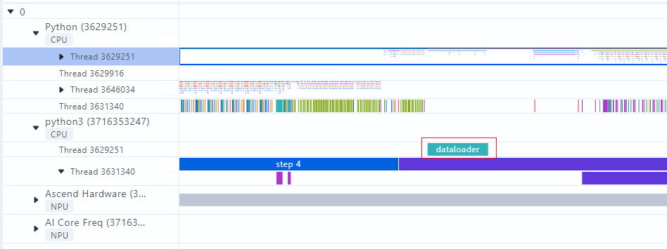

# mstx_torch_plugin

The [collect and parse `msprof_tx` data](https://gitcode.com/Ascend/pytorch/blob/master/docs/en/developer_notes/ascend_pytorch_profiler_user_guide.md#profile-and-parse-mstx-data) feature in Ascend PyTorch Profiler already includes instrumentation for communication operators. To help you obtain duration data for more key stages without modifying your service code, `mstx_torch_plugin` adds instrumentation for the following four key-stage functions in Ascend PyTorch Profiler: `dataloader`, `forward`, `step`, and `save_checkpoint`.

## Constraints

PyTorch graph mode is not currently supported.

## Usage Instructions

1. Download the `mstx_torch_plugin` wheel package.

   Download the `mstx_torch_plugin` wheel package from the link in the following table.

   | Version | Release Date | Download Link | Checksum |
   | ---- | ---------- | ------------------------------------------------------------ | ------------------------------------------------------------ |
   | 1.0  | 2024-12-19 | [mstx_torch_plugin-1.0-py3-none-any.whl](https://ptdbg.obs.myhuaweicloud.com/profiler/example/1.0/mstx_torch_plugin-1.0-py3-none-any.whl) | 8b3500245ac0ea63f2ada832b1cc67ca8923a86d6081b165a8f62da0a276cbaa |

2. Verify the wheel package.

   1. Download the wheel package to the Linux installation environment from the download link in the table.

   2. Change to the directory that contains the wheel package and run the following command.

      ```bash
      sha256sum {name}.whl
      ```

      `{name}` is the name of the wheel package.

      If the echoed checksum matches the checksum for the corresponding wheel package version, you downloaded the correct performance tool wheel package. An example follows:

      ```bash
      sha256sum mstx_torch_plugin-1.0-py3-none-any.whl
      xx *mstx_torch_plugin-1.0-py3-none-any.whl
      ```

3. Install `mstx_torch_plugin`.

   ```bash
   pip install mstx_torch_plugin-1.0-py3-none-any.whl
   ```

4. Import the wheel package into the AI task execution script.

   Ensure that you import it after `torch` and `torch_npu`:

   ```python
   import torch
   import torch_npu

   import mstx_torch_plugin
   ```

5. Enable `torch_npu.profiler` to collect instrumentation data.

   Turn on the `msprof_tx` switch. Configure the `profiler_level` switch to the appropriate level based on your collection requirements:

   ```python
   import torch
   import torch_npu

   import mstx_torch_plugin
   ...
   experimental_config = torch_npu.profiler._ExperimentalConfig(
      export_type=torch_npu.profiler.ExportType.Text,
      profiler_level=torch_npu.profiler.ProfilerLevel.Level_none
   )

   with torch_npu.profiler.profile(
      activities=[
         torch_npu.profiler.ProfilerActivity.CPU,
         torch_npu.profiler.ProfilerActivity.NPU
         ],
      schedule=torch_npu.profiler.schedule(wait=0, warmup=0, active=1, repeat=1, skip_first=1),
      on_trace_ready=torch_npu.profiler.tensorboard_trace_handler("./result"),
      experimental_config=experimental_config) as prof:
         for step in range(steps):
            train_one_step(step, steps, train_loader, model, optimizer, criterion)
            prof.step()
   ```

## Collection Results

Open the collected performance data with the MindStudio Insight tool. The visualization appears as follows:



The figure uses the `dataloader` function as an example. As with `mstx` data, the results appear in the application-level data.
